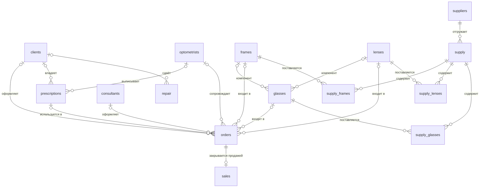

# База данных магазина оптики

Учебный проект на PostgreSQL для учёта товаров, рецептов, заказов, продаж, поставок и ремонта. Схема содержит 15 таблиц, 14 функций, 7 процедур и 8 триггеров. В примерах используются вымышленные клиенты, сотрудники и поставщики.

## Возможности

- Готовые очки и индивидуальные заказы с подбором оправы, линзы и рецепта клиента.
- Приёмка поставок из JSON, расчёт суммы поставки и обновление складских остатков.
- Расчёт суммы продажи, списание товаров и восстановление остатка при отмене.
- Автопополнение при наличии поставщика. Блокировки строк товара защищают остатки при одновременных продажах, а уникальное ограничение защищает заказ от повторной продажи.
- Приём и завершение ремонта, отчёт по выручке за месяц.

## Схема связей



Схема допускает пустые ссылки для некоторых ролей. Тип заказа определяет, какая комбинация товаров обязательна. Если заказ ссылается на рецепт, составной внешний ключ проверяет его принадлежность клиенту.

## Быстрый запуск

Схема проверена на PostgreSQL 18.2. Выполняйте команды из корня репозитория. Используйте тестовый сервер и свободное имя базы. Параметры подключения можно задать через `PGHOST`, `PGPORT` и `PGUSER`. На Windows см. [запуск через PowerShell](docs/windows.md).

```sh
createdb -T template0 optical_store_demo
psql -X -d optical_store_demo -v ON_ERROR_STOP=1 -1 -f sql/01_schema.sql
psql -X -d optical_store_demo -v ON_ERROR_STOP=1 -f sql/02_demo_data.sql
psql -X -d optical_store_demo -v ON_ERROR_STOP=1 -f sql/03_example_queries.sql
```

Демонстрация проводит одну обычную поставку, три продажи и два ремонта. Вторая продажа готовых очков вызывает автопоставку. Выручка за текущий месяц составляет `9700.00`, запас после продаж — одна оправа, одна линза и ноль готовых очков.

## Тесты

Запускайте тесты в свежих базах после загрузки схемы и до демонстрационных данных.

```sh
createdb -T template0 optical_store_test
psql -X -d optical_store_test -v ON_ERROR_STOP=1 -1 -f sql/01_schema.sql
psql -X -d optical_store_test -f tests/01_integrity.sql
```

Основной набор проверяет 194 сценария, включая развёртывание, ограничения, расчёты, переходы статусов, отказ и откат поставки. Тестовые записи откатываются.

```sh
createdb -T template0 optical_store_parallel_test
psql -X -d optical_store_parallel_test -v ON_ERROR_STOP=1 -1 -f sql/01_schema.sql
psql -X -d optical_store_parallel_test -f tests/02_concurrency.sql
```

Две параллельные проверки используют расширение `dblink` и отдельные сеансы. Нужны право создать расширение и возможность подключиться к тестовой базе из процесса PostgreSQL. По умолчанию используется `127.0.0.1` с портом текущего PostgreSQL. При другой настройке передайте `-v audit_conn=...`, а пароль храните в файле паролей PostgreSQL.

## Правила учёта

- Индивидуальный заказ можно продать после перехода в `готов`. Готовые очки можно продать из статусов `создан` и `готов`.
- Сумма продажи сохраняется на момент оформления. При отмене продажа удаляется, товар возвращается на склад, а статус заказа восстанавливается.
- Автопоставка использует цену из каталога и поставщика с наименьшим `id_sup`. Это правило учебного проекта.
